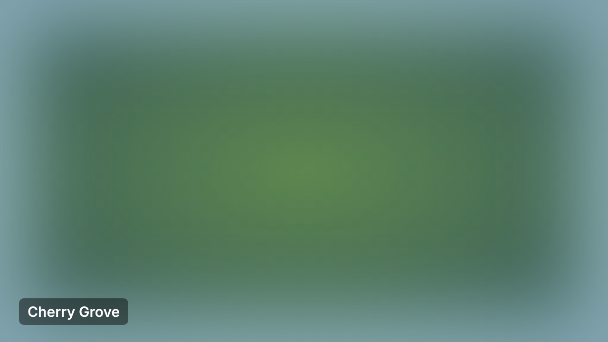
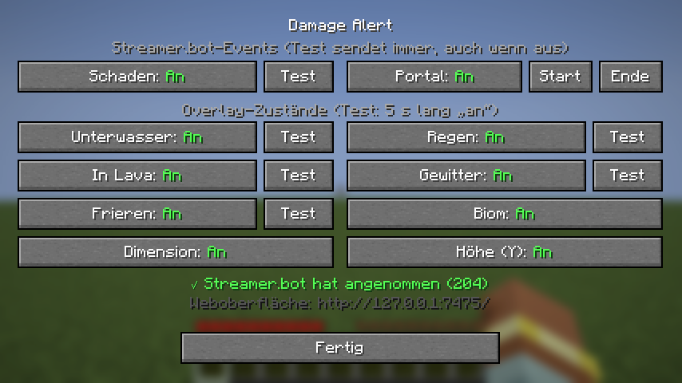
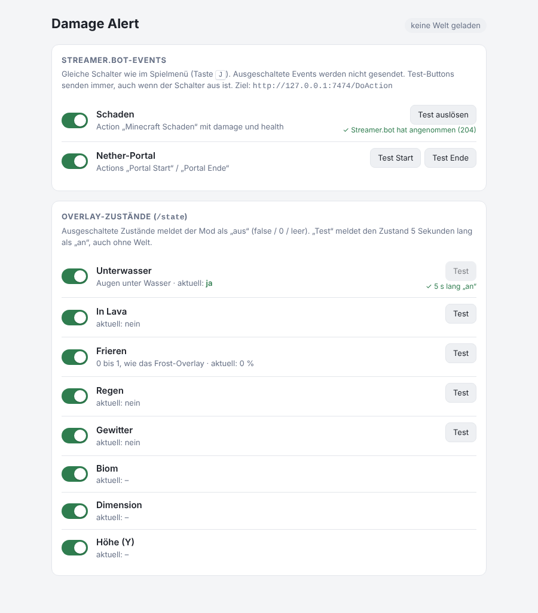

# Damage Alert – Minecraft-Ereignisse im Stream

Ein kleiner Fabric-Mod für **Minecraft Java 1.21.11**, der bemerkt, was im Spiel passiert, und es an
deinen Stream weitergibt:

- **Einmalige Ereignisse → Streamer.bot**: Wenn du Schaden bekommst oder ein Nether-Portal betrittst
  bzw. verlässt, schickt der Mod eine Action an Streamer.bot. Streamer.bot löst dann z. B. einen
  Effekt in OBS aus.
- **Dauerhafte Zustände → OBS-Overlay**: Ob du unter Wasser bist, in Lava stehst, frierst, in
  welchem Biom du bist, ob es gewittert … Ein Overlay in OBS fragt das laufend beim Mod ab.

Der Mod **liest nur**. Er schickt nichts an den Minecraft-Server, simuliert keine Eingaben und
ändert nichts am Spiel. Alles läuft nur auf deinem eigenen PC.

---

## Inhalt

1. [Was du brauchst](#1-was-du-brauchst)
2. [Mod installieren](#2-mod-installieren)
3. [Streamer.bot einrichten](#3-streamerbot-einrichten)
4. [OBS-Overlay einrichten](#4-obs-overlay-einrichten)
5. [Testen, ob alles ankommt](#5-testen-ob-alles-ankommt)
6. [Bedienung: Effekte an- und ausschalten](#6-bedienung-effekte-an--und-ausschalten)
7. [Einstellungen (Config-Datei)](#7-einstellungen-config-datei)
8. [Was der Mod genau sendet](#8-was-der-mod-genau-sendet)
9. [Probleme lösen](#9-probleme-lösen)
10. [Für Entwickler: selbst bauen und testen](#10-für-entwickler-selbst-bauen-und-testen)

---

## 1. Was du brauchst

| Was | Wofür |
|---|---|
| **Minecraft Java 1.21.11 mit Fabric** (z. B. ein Profil im NoRisk Client) | Hier läuft der Mod |
| **Fabric API** für 1.21.11 (`0.141.6+1.21.11` oder neuer) | Wird vom Mod benötigt |
| **`damagealert-1.0.0.jar`** | Der Mod selbst (siehe [Abschnitt 10](#10-für-entwickler-selbst-bauen-und-testen), wie man ihn baut) |
| **Streamer.bot** | Nimmt die Ereignisse entgegen und steuert OBS |
| **OBS Studio** | Für das Overlay mit den Dauerzuständen |

Streamer.bot und OBS sind nur nötig für den jeweiligen Teil. Wenn du z. B. nur das Overlay willst,
reicht OBS.

---

## 2. Mod installieren

1. Lege **`damagealert-1.0.0.jar`** in den Mod-Ordner deines Fabric-Profils.
   - **Nicht** die Datei `damagealert-1.0.0-sources.jar` nehmen. Die enthält nur den Quellcode.
   - **NoRisk Client:** Öffne im Launcher dein 1.21.11-Profil und füge die .jar als eigene Mod hinzu
     (je nach Launcher-Version per Drag & Drop in die Mod-Liste oder über „Profil-Ordner öffnen“ →
     `mods`).
   - **Andere Launcher / Vanilla-Fabric:** in den Ordner `.minecraft/mods`.
2. Prüfe, ob **Fabric API** im selben Profil installiert ist. Ohne Fabric API startet der Mod nicht.
   Der NoRisk Client hat sie oft schon dabei.
3. Starte Minecraft. Wenn alles klappt, steht in der Log-Datei (`logs/latest.log` im Profil-Ordner):
   ```
   [DamageAlert] Zustands-Server laeuft auf http://127.0.0.1:7475/state , Oberflaeche: http://127.0.0.1:7475/
   ```
   Beim ersten Start legt der Mod außerdem die Datei `config/damagealert.properties` an.

---

## 3. Streamer.bot einrichten

### 3.1 HTTP-Server einschalten
Der Mod schickt seine Ereignisse an den eingebauten HTTP-Server von Streamer.bot.

1. In Streamer.bot den Reiter **Servers/Clients** öffnen, dort **HTTP Server**.
2. Adresse `127.0.0.1`, Port **`7474`** (Standard) einstellen.
3. **Auto Start** anhaken und den Server **starten**.

### 3.2 Actions anlegen
Lege im Reiter **Actions** drei Actions an. Die Namen müssen **exakt** so heißen (Groß-/Kleinschreibung
und Leerzeichen beachten). Du kannst sie in der Config auch umbenennen, siehe [Abschnitt 7](#7-einstellungen-config-datei).

| Action-Name | Wann sie kommt | Mitgeschickte Werte |
|---|---|---|
| `Minecraft Schaden` | Deine Herzen sinken | `%damage%` = verlorene HP, `%health%` = verbleibende HP (20 = volle 10 Herzen) |
| `Portal Start` | Du betrittst ein Nether-Portal | – |
| `Portal Ende` | Du verlässt das Portal oder wechselst die Dimension | – |

In jede Action fügst du als Sub-Actions ein, was passieren soll. Beispiele:
- OBS-Quelle kurz einblenden (z. B. roter Bildschirmrand bei Schaden), etwas warten, wieder ausblenden.
- Bei `Portal Start` einen Filter einschalten, bei `Portal Ende` wieder aus.
- Die Werte `%damage%` und `%health%` kannst du in Sub-Actions verwenden, z. B. in einer Chat-Nachricht
  oder in einer If-Abfrage („nur bei mehr als 4 Schaden“).

> Gut zu wissen: Schaden wird höchstens **einmal pro Sekunde** gemeldet (einstellbar). Treffer
> innerhalb dieser Sekunde werden nicht nachgeholt. Direkt nach dem Betreten einer Welt, nach einem
> Respawn oder Dimensionswechsel wartet der Mod 2 Sekunden. In der Zeit überträgt der Server erst die
> echten HP, das wäre sonst fälschlich als Schaden erkannt worden.

---

## 4. OBS-Overlay einrichten

Der Mod stellt die Dauerzustände unter **http://127.0.0.1:7475/state** bereit (solange Minecraft
läuft). Ein Overlay in OBS fragt diese Adresse regelmäßig ab.

### Mit dem mitgelieferten Beispiel-Overlay
1. In OBS: **Quelle hinzufügen → Browser**.
2. **Lokale Datei** anhaken und `overlay/beispiel-overlay.html` aus diesem Projekt auswählen.
3. Breite `1920`, Höhe `1080` (bzw. deine Canvas-Größe).
4. Die Quelle **über** deine Spielaufnahme legen.

Das Beispiel zeigt:
- einen blauen Schleier unter Wasser
- einen orangen Rand in Lava
- einen Frostrand beim Frieren, je stärker, desto mehr
- ein Flackern bei Gewitter
- den Namen des Bioms, wenn er sich ändert


*(Hier über grünem Testhintergrund. In OBS liegt es über deinem Spielbild.)*

Läuft Minecraft nicht, ist das Overlay unsichtbar. Farben und Effekte kannst du direkt in der HTML-Datei
anpassen, die Stellen sind kommentiert.

### Eigenes Overlay
Frag `http://127.0.0.1:7475/state` mit `fetch` ab (z. B. alle 200–500 ms). Die Felder stehen in
[Abschnitt 8](#8-was-der-mod-genau-sendet). Die Abfrage funktioniert auch aus einer lokalen Datei heraus.

---

## 5. Testen, ob alles ankommt

Du musst dafür nicht extra Schaden nehmen:

1. Streamer.bot und OBS starten, dann Minecraft.
2. Im Spiel **J** drücken (oder im Browser **http://127.0.0.1:7475/** öffnen).
3. Bei „Schaden“ auf **Test** klicken:
   - **„✓ Streamer.bot hat angenommen (204)“**: Die Verbindung steht. Prüfe in Streamer.bot, ob die
     Action gelaufen ist. Der Test schickt `damage = 2` und `health = 18`.
   - **„✗ Streamer.bot nicht erreichbar“**: siehe [Probleme lösen](#9-probleme-lösen).
4. Bei „Portal“ auf **Start** und **Ende** klicken.
5. Bei einem Zustand, z. B. „Unterwasser“, auf **Test** klicken. Das Overlay sollte den Effekt jetzt
   5 Sekunden lang zeigen. Das geht auch im Hauptmenü über die Weboberfläche.
6. Danach echt ausprobieren: Schaden nehmen, durch ein Portal gehen, abtauchen.

---

## 6. Bedienung: Effekte an- und ausschalten

Jeden Effekt kannst du einzeln abschalten, auf zwei Wegen. Beide Wege zeigen immer denselben Stand.
Was du im Spiel umschaltest, sieht die Weboberfläche sofort, und umgekehrt.

**Im Spiel:** Taste **J** öffnet das Damage-Alert-Menü. Die Taste kannst du unter
*Optionen → Steuerung → Damage Alert* ändern, falls J schon belegt ist. Das Menü ist reine Anzeige auf
deinem PC, es geht nichts an den Server.



**Im Browser:** Solange Minecraft läuft, **http://127.0.0.1:7475/** öffnen. Das geht auch, während du
im Hauptmenü bist.



Was „aus“ bedeutet:
- **Schaden / Portal aus**: Es wird nichts an Streamer.bot geschickt. Schaltest du das Portal aus,
  während du drinstehst, kommt noch einmal „Portal Ende“, damit kein Effekt hängen bleibt.
- **Zustand aus** (z. B. Unterwasser): Der Mod meldet ihn dem Overlay immer als „aus“, also `false`,
  `0` oder leer.
- **Test-Buttons** funktionieren immer, auch wenn der Effekt ausgeschaltet ist.

Die Schalter werden in der Config gespeichert und gelten auch nach einem Neustart.

---

## 7. Einstellungen (Config-Datei)

Die Datei `config/damagealert.properties` in deinem Profil-Ordner kannst du mit jedem Texteditor
öffnen. Änderungen an Ports, Action-Namen und Cooldown gelten **nach einem Neustart** von Minecraft.

| Einstellung | Standard | Bedeutung |
|---|---|---|
| `streamerbot.port` | `7474` | Port des Streamer.bot-HTTP-Servers |
| `state.port` | `7475` | Port für `/state` und die Weboberfläche |
| `action.damage` | `Minecraft Schaden` | Name der Schadens-Action in Streamer.bot |
| `action.portalStart` | `Portal Start` | Name der Action beim Betreten des Portals |
| `action.portalEnd` | `Portal Ende` | Name der Action beim Verlassen |
| `damage.cooldownMs` | `1000` | Mindestabstand zwischen zwei Schadens-Meldungen (Millisekunden) |
| `enabled.<effekt>` | `true` | An/Aus-Schalter. Am einfachsten über Menü oder Weboberfläche ändern. |

Ungültige Werte, z. B. Buchstaben statt einer Zahl, ignoriert der Mod. Er nimmt dann den
Standardwert und schreibt eine Warnung ins Log.

---

## 8. Was der Mod genau sendet

### An Streamer.bot
`POST http://127.0.0.1:7474/DoAction`, z. B.:
```json
{"action":{"name":"Minecraft Schaden"},"args":{"damage":4,"health":16}}
{"action":{"name":"Portal Start"},"args":{}}
```
Das Senden läuft im Hintergrund. Läuft Streamer.bot nicht oder antwortet nicht, ignoriert der Mod
das. Das Spiel ruckelt dadurch nicht und stürzt nicht ab.

### An das Overlay: `GET http://127.0.0.1:7475/state`
```json
{"inWorld":true,"underwater":false,"inLava":false,"freeze":0.4,
 "biome":"minecraft:cherry_grove","dimension":"minecraft:overworld",
 "y":64,"raining":false,"thundering":false}
```

| Feld | Bedeutung |
|---|---|
| `inWorld` | `true`, wenn du in einer Welt bist (nicht im Menü) |
| `underwater` | Augen unter Wasser |
| `inLava` | Du stehst in Lava |
| `freeze` | Wie stark du frierst, `0` bis `1` (wie der Frostrand im Spiel) |
| `biome` | Biom an deiner Position, z. B. `minecraft:plains` |
| `dimension` | `minecraft:overworld`, `minecraft:the_nether`, `minecraft:the_end` |
| `y` | Deine Höhe (Y-Koordinate) |
| `raining` / `thundering` | Regen bzw. Gewitter in der Welt |

Ohne Welt (Hauptmenü): `inWorld:false`, alle Werte aus, `biome`, `dimension` und `y` sind `null`.

---

## 9. Probleme lösen

**Test zeigt „✗ Streamer.bot nicht erreichbar“**
- Läuft Streamer.bot? Ist der HTTP-Server gestartet (Abschnitt 3.1)?
- Stimmt der Port? Er muss in Streamer.bot und in `streamerbot.port` gleich sein.

**Test zeigt „✓ angenommen“, aber in Streamer.bot passiert nichts**
- Heißt die Action **exakt** wie in der Tabelle in Abschnitt 3.2 bzw. wie in der Config?
- Ist die Action in Streamer.bot aktiviert und hat sie Sub-Actions?

**Taste J öffnet das Menü nicht**
- Vermutlich ist J schon von etwas anderem belegt, z. B. vom NoRisk Client. Unter *Optionen → Steuerung
  → Damage Alert* eine andere Taste wählen.
- Das Menü öffnet sich nur, wenn gerade kein anderes Fenster (Inventar, Chat …) offen ist.

**Overlay zeigt nichts**
- Öffne http://127.0.0.1:7475/state im Browser, während Minecraft läuft. Kommt dort Text mit
  `"inWorld"`? Wenn nicht, siehe nächster Punkt.
- Mit den Test-Buttons (Abschnitt 5) prüfen, ob das Overlay grundsätzlich reagiert.
- In OBS bei der Browserquelle „Lokale Datei“ angehakt? Quelle liegt über der Spielaufnahme?

**http://127.0.0.1:7475/ lädt nicht, im Log steht „konnte Port 7475 nicht oeffnen“**
- Ein anderes Programm benutzt den Port. In der Config `state.port` auf einen anderen Wert setzen
  (z. B. `7480`), Minecraft neu starten und im Overlay die Adresse anpassen. Das Spiel läuft
  auch ohne diesen Teil normal weiter.

**Wo finde ich das Log?**
`logs/latest.log` im Ordner deines Minecraft-Profils. Alle Zeilen des Mods beginnen mit `[DamageAlert]`.

### Sicherheit und Anti-Cheat
- Der Mod liest nur Werte, die dein Client ohnehin kennt. Er schickt keine Pakete an Server,
  simuliert keine Eingaben und verwendet keine Mixins.
- Beide Adressen (`:7474` Streamer.bot, `:7475` Mod) sind nur auf deinem eigenen PC erreichbar
  (`127.0.0.1`), nicht aus dem Netzwerk oder Internet.
- Schalter und Test-Buttons lassen sich nur über die eigene Oberfläche bedienen. Fremde Webseiten
  können keine Effekte auslösen.
- `/state` darf jede Seite lesen, damit OBS es aus einer lokalen Datei abfragen kann. Darin stehen nur
  die Werte aus Abschnitt 8, also z. B. Biom und Höhe, keine Koordinaten X/Z.
- Ob ein bestimmter Server Mods generell erlaubt, regelt der jeweilige Server. Im Zweifel dort nachlesen.

---

## 10. Für Entwickler: selbst bauen und testen

Voraussetzung: **JDK 21** (`java -version` muss 21 anzeigen). Alles Weitere lädt Gradle selbst.

Unter Windows in der Eingabeaufforderung im Projektordner:
```bat
gradlew.bat build
```
Die fertige Mod liegt danach in `build\libs\damagealert-1.0.0.jar`.

Weitere Befehle (unter Linux/macOS `./gradlew` statt `gradlew.bat`):

| Befehl | Was er macht |
|---|---|
| `gradlew.bat runClient` | Startet Minecraft mit dem Mod (Entwicklungsmodus, offline) |
| `gradlew.bat test` | Unit-Tests: Config, JSON, Oberflächen-API, Streamer.bot aus/hängt |
| `gradlew.bat runClientGameTest` | Automatischer Ingame-Test: startet Minecraft, erzeugt eine Welt und prüft Schaden, Portal, Zustände, Menü und Schalter |
| `java tools\MockStreamerBot.java` | Fake-Streamer.bot auf Port 7474, zeigt jeden eingehenden Request an. Damit kannst du ohne Streamer.bot testen. Der echte Streamer.bot darf dabei nicht laufen. |

### Projektaufbau
```
src/main/      Teil ohne Minecraft-Abhängigkeit: Config, Streamer.bot-Versand, lokaler Server, Weboberfläche
src/client/    Liest die Spielwerte im Client-Tick, Ingame-Menü, Tastenbelegung
src/test/      Unit-Tests (JUnit)
src/gametest/  Automatischer Ingame-Test (landet nicht in der fertigen Mod)
overlay/       Beispiel-Overlay für OBS
tools/         Fake-Streamer.bot zum Testen
```

### Versionen
Minecraft 1.21.11 · Fabric Loader 0.19.5 · Fabric API 0.141.6+1.21.11 · Yarn 1.21.11+build.6 ·
Fabric Loom 1.17.21 · Gradle 9.7.1 · Java 21.
Loom 1.18 würde zum Bauen Java 25 brauchen, deshalb 1.17.
